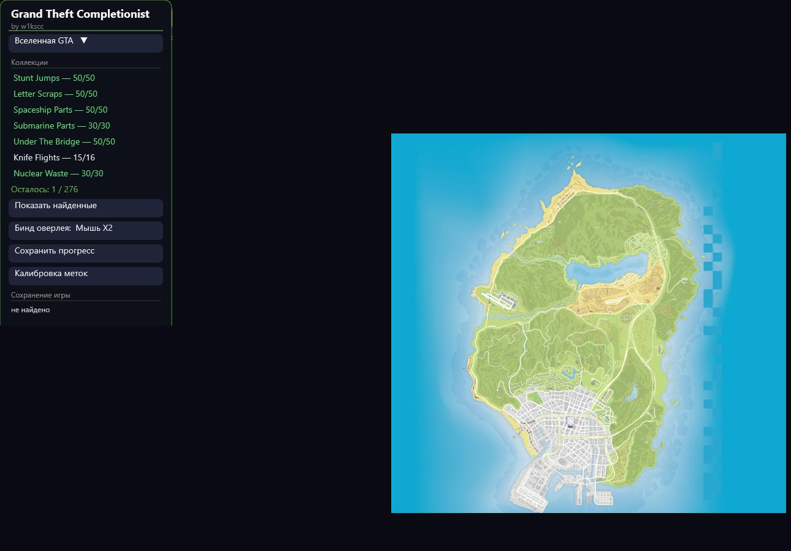

# Grand Theft Completionist



**Grand Theft Completionist** (by w1kscc) — inside-game overlay for GTA III, Vice City, San Andreas, IV (incl. EFLC) and V (Legacy & Enhanced) that shows collectible locations on an interactive map **and automatically hides every collectible you have already found** — straight from your save file.

> Оверлей «всё-в-одном» для коллекционок GTA: карта с метками поверх игры + автоматическое скрытие найденного по вашему сейву. Никаких ручных галочек.

---

## Чем отличается от MapGenie (mapgenie.io)

| | **Grand Theft Completionist** | **MapGenie** |
|---|---|---|
| Формат | Оверлей поверх игры (Direct2D, всегда поверх окна GTA) | Сайт/приложение в отдельном окне или телефоне |
| Отметки «собрано» | **Автоматически из сейва** — нашёл предмет, сохранился, иконка скрылась | Вручную: тапать каждую иконку самому |
| Точность скрытия | **По-предметно**: читаются флаги/биты сейва — скрыта именно та иконка, что собрана (≈40 категорий) | Только ручной чеклист |
| Синхронизация с прогрессом | Мгновенно: перечитывает самый свежий сейв по дате изменения каждые пару секунд | Нет связи с игрой |
| Интернет | **Не нужен** — всё офлайн | Нужен (сайт) |
| Цена | Бесплатно, без рекламы | Free с рекламой + платная Pro-подписка |
| Версии игр | DE **и** классика III/VC/SA, IV + EFLC (TLAD/TBOGT), GTA V Legacy **и** Enhanced, лицензия **и** пиратки (Goldberg/RUNE) | Один набор карт без учёта версии сейвов |
| Приватность | Ничего не отправляет наружу, работает с локальными файлами | Аккаунт, синхронизация в облако |

**Главная фишка:** оверлей сам узнаёт, что вы собрали. Никаких «отметь галочкой 200 голубей» — сейв говорит сам.

---

## Возможности

- 🗺️ Интерактивные карты всех 5 игр (склеены из тайлов MapGenie, метки и иконки — оттуда же)
- 🎯 Автоскрытие найденного: per-item флаги, битовые маски, packed-статы — для каждой игры расшифрован свой формат сейва
- 🕐 Автовыбор самого свежего сейва (по дате изменения) среди DE/классики/Legacy/Enhanced/пираток
- 🖼️ Попап-карточки с фото локаций, fullscreen, кнопки «Нашёл»/«Вернуть» для ручных отметок
- 🧷 Тонкая настройка: бинд оверлея (мышь X1/X2/СКМ/клавиши), калибровка меток, скрытие категорий
- 👥 Универсальные пути сейвов — работает у любого пользователя Windows без настройки (лицензия и пиратки)
- 📄 Диагностический лог `%APPDATA%\GrandTheftCompletionist\log.txt`

### Автоскрытие по играм

| Игра | Категории из чеклиста 100% | Механика |
|---|---|---|
| **GTA SA** (DE + классика) | Gang Tags (100), Snapshots (50), Horseshoes (50), Oysters (50), Unique Stunt Jumps (70) | биты/флаги секций сейва + счётчики |
| **GTA III** (DE + классика) | Hidden Packages (100), Stunt Jumps (20), Rampages (20) | пикапы + SCR-глобалы main.scm |
| **GTA VC** (DE + классика) | Hidden Packages (100), Stunt Jumps (36), Rampages (35), Store Robberies (15) | пикапы + SCR-глобалы |
| **GTA IV** | Pigeons (200), Stunt Jumps (50) | флаги пикапов + блок прыжков |
| **GTA V** (Legacy + Enhanced) | Stunt Jumps (50), Letter Scraps (50), Spaceship Parts (50), Submarine Parts (30), Nuclear Waste (30), Under The Bridge (50), Knife Flights (15) | SP_PSTAT_BOOL биты, USJS-маска, счётчики |

Форматы, которые пришлось вскрыть: AES-256-ECB (GTA V PSIN/PMAP/PSCH), zlib-инфляция DE-сейвов, RAGE PSO-структуры, SCR-глобалы main.scm классики, упакованные статы SP_PSTAT_BOOL0-8.

---

## Установка

1. Скачайте `GTC.zip` (Releases) и распакуйте в любую папку
2. Запустите `GrandTheftCompletionist.exe`
3. Играйте; оверлей сам найдёт свежий сейв и скроет собранное

Бинд показа оверлея по умолчанию — **Мышь X2**, меняется в меню. Закрытие — иконка в трее.

## Структура пакета

```
GrandTheftCompletionist.exe
data\<игра>\        — координаты меток + иконки категорий
assets\maps\        — карты игр
```

## Сборка из исходников

- `src/main.cpp` — весь оверлей (один файл, ~2600 строк, Win32 + Direct2D)
- Компилятор: [zig c++](https://ziglang.org/) — `build_unicode_fixed.bat`
- Зависимостей нет, только WinAPI

## Заметки

- Прогресс для категорий-«счётчиков» (напр. Under The Bridge) скрывает первые N меток: игра хранит только общее число — это потолок формата сейва, доказано разбором ~200 сейвов
- Если сейв не найден — причина всегда в логе (`save: не найдено (game=… de=… root=…)`)

## Disclaimer

Проект не аффилирован с Rockstar Games и MapGenie. GTA и все связанные торговые марки принадлежат их владельцам. Карты и иконки локаций — courtesy of MapGenie (mapgenie.io), координаты собраны из открытых источников. Используйте только в одиночных режимах игр.
